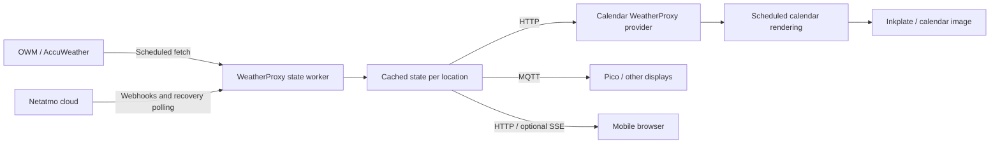

# WeatherProxy design for 4.2

Status: proposed design; implementation has not started.

WeatherProxy is a local service that obtains forecasts and observations from
upstream weather providers, maintains normalized cached state for multiple
locations, and serves that state to calendars, browser clients, and MQTT devices.
Develop it on `feature/weather-proxy`, beginning with this design commit.

## Goals and boundaries

- Support OpenWeatherMap, AccuWeather, and Netatmo through shared provider code.
- Preserve direct provider access in the calendar as an alternative to the proxy.
- Support multiple configured locations from the outset, including discovery
  through `GET /api/v1/locations`.
- Refresh observations independently of forecasts, calendar rendering, and
  client requests.
- Accept Netatmo weather webhooks, with polling for startup and recovery.
- Publish useful, timestamped weather state over MQTT and HTTP.
- Let multiple clients share upstream fetches and provider request budgets.

The proxy owns weather acquisition and distribution. Calendar images, static
maps, calendar layout, and Inkplate diagnostics remain calendar responsibilities.
Historical analytics, alert rules, background phone notifications, and general
device management are outside the initial scope.

"Local" means the proxy runs on the user's LAN. Its Netatmo integration still
uses the Netatmo cloud; this design does not introduce direct station access.
Deployments without a public callback endpoint can use polling.

## Why introduce a service?

Currently `server/server.py` fetches a forecast, overlays Netatmo observations,
renders output profiles, stores a snapshot, and publishes MQTT in one cycle.
The example configuration uses a 180-minute interval. Rendering must succeed
before the snapshot and MQTT weather state are published. That couples current
conditions to a workload and schedule intended for calendar images.

The PWA currently reloads a calendar PNG every 15 minutes. The Pico example
already redraws on receipt of a complete MQTT snapshot. Faster weather
publication therefore benefits the Pico immediately, while the browser needs a
live conditions view or more frequent image generation to show the improvement.

Extracting a proxy makes this behavior reusable independently of the calendar.
It also moves OWM and other forecast acquisition into the same service, rather
than creating a Netatmo-only relay.



## Shared providers and calendar modes

Extract provider adapters and normalized weather models into a shared Python
package in this repository. Reuse the existing provider registry and model
concepts where suitable; the package must not depend on Flask, MQTT, rendering,
or calendar artifact storage. Its exact package name is an implementation choice.

WeatherProxy and the calendar's direct mode use the same adapter implementations
for `openweathermapv3`, `openweathermapv4`, `accuweather`, and `netatmo`.

| Calendar mode | Acquisition | Credentials and refresh ownership |
| --- | --- | --- |
| Direct | Existing forecast and optional observation adapters | Calendar deployment |
| WeatherProxy | New HTTP adapter reading a configured proxy location | Proxy owns upstream credentials and schedules |

Existing direct configurations continue to work. Proxy mode is explicit and
must not silently fall back to direct upstream calls on a proxy failure.
Such fallback would require credentials on every client and defeat centralized
quota management.

Illustrative calendar configuration, not yet accepted by the parser:

```yaml
weather:
  service: weatherproxy
  url: http://weather-proxy:8090
  location: landry # stable proxy location ID
  metric: true
```

In proxy mode, use the proxy's composed forecast and current conditions. Do not
apply a second calendar-side Netatmo overlay. The calendar continues to own its
output dimensions, forecast slicing, render interval, and Google Maps settings.
The adapter must make the selected location's coordinates and timezone available
to calendar consumers without treating `landry` as a geocodable place name.

## Locations, accounts, and scheduling

A location has a stable ID, display name, coordinates, timezone, forecast source,
and optional observation sources. Model stations and modules explicitly rather
than flattening every measurement into one unqualified "current" reading.
This supports outdoor conditions for a calendar and indoor CO2 or humidity for
another display without conflating the sensors.

Provider accounts are separate resources referenced by locations. Several
locations can share an account and its request budget. One Netatmo station-data
response can supply several stations; distribute those results instead of
fetching separately for each location. Route events by account, user, station,
and module identity, never by a display name supplied in the webhook.

Illustrative proxy configuration:

```yaml
accounts:
  owm:
    provider: openweathermapv3
    apikey: ${WEATHER_API_KEY}
  netatmo:
    provider: netatmo
    client_id: ${NETATMO_CLIENT_ID}
    client_secret: ${NETATMO_CLIENT_SECRET}
    refresh_token: ${NETATMO_REFRESH_TOKEN}
locations:
  landry:
    name: Landry
    latitude: 45.57 # illustrative; configure actual coordinates
    longitude: 6.74
    timezone: Europe/Paris
    forecast:
      account: owm
      refresh_minutes: 180
    observations:
      - account: netatmo
        device_id: configured-station-id
        module_id: configured-outdoor-module-id
```

Forecast fetches, observation polling/reconciliation, MQTT publication, and
calendar rendering have independent schedules. Client GET requests read cached
state and never trigger upstream requests. Startup, retries, webhook-triggered
fetches, and scheduled fetches all pass through the same account budget and
request coalescing logic. Honor provider rate-limit responses and use backoff
with jitter rather than retrying independently for every location or client.

## State and freshness

Maintain forecasts and observations separately, then compose a location snapshot
using explicit source selection. Preserve the underlying observations so clients
can inspect modules that are not selected for the calendar's current conditions.

Each published snapshot needs a revision, assembly time, location ID, units,
forecast timestamps, and observation provenance and freshness. Preserve provider
measurement times per module or measurement; they need not advance together.
Track receipt and successful-fetch times separately from measurement times.
`generated_at` must not imply that every measurement was just taken.

Merge partial observation updates: an absent field does not erase a previous
reading. Explicit removal, unreachability, and stale readings are distinct
states. Keep normalized measurement precision and apply display rounding in
clients. Preserve the original timestamps when reusing cached values.

Define configurable freshness policies. Mark old observations stale and identify
forecast-derived fallback fields explicitly. A new forecast must not make an
old Netatmo reading look live. A forecast outage must not prevent valid new
observations from being published. Locations with observations but no usable
forecast can expose partial state; the calendar adapter must report insufficient
forecast data instead of constructing a fabricated forecast.

Persist cached state and revisions across restarts. Use one worker to own state
mutation and publication; HTTP processes read state and enqueue accepted events.
A small SQLite database on a local persistent volume is an initial option for
the inbox and state. In-memory queues cannot bridge the existing separate
producer/web processes or multiple Gunicorn workers reliably.

## HTTP API

The following routes are proposed contracts, not existing endpoints:

| Method and route | Purpose |
| --- | --- |
| `GET /api/v1/locations` | Discover configured locations |
| `GET /api/v1/locations/{id}/weather` | Read a composed forecast/current snapshot |
| `GET /api/v1/locations/{id}/observations` | Read station/module measurements and freshness |
| `GET /api/v1/health` | Process liveness |
| `GET /api/v1/status` | Sanitized upstream, freshness, and publication status |
| `POST /api/v1/integrations/netatmo/webhook` | Receive signed Netatmo events |

Location discovery is a required feature, even for a single-location deployment:

```json
{
  "locations": [
    {
      "id": "landry",
      "name": "Landry",
      "timezone": "Europe/Paris",
      "latitude": 45.57,
      "longitude": 6.74
    }
  ]
}
```

An empty configuration returns an empty list. Unknown location IDs return 404;
configured locations awaiting data return 503 from the weather route. Available
cached weather remains readable during an upstream outage with explicit stale
or degraded metadata. Use ETags for conditional reads, UTC timestamps on the
wire, and a versioned payload schema. Location timezone controls local display
and forecast interpretation.

Reuse the existing weather snapshot shape (`current`, `hourly`, explicit units)
where practical, adding location, revision, and freshness metadata. Before
implementation, specify the complete proxy schema and its mapping to the
calendar's existing schema 2.0; API version and payload schema version are
separate contracts. Support explicit unit selection without another upstream
fetch, keeping conversions consistent across HTTP and MQTT.

Discovery exposes coordinates, so apply deployment access policy consistently
to all client routes. Never return credentials or raw provider account records.
Expose only the callback route to Netatmo through a public HTTPS reverse proxy;
LAN client access does not require exposing the rest of the API publicly.

## Netatmo webhooks

The [current webhook guide](https://dev.netatmo.com/apidocumentation/webhooks),
reviewed on 2026-11-06, explicitly lists NAMain / `read_station` as supported.
It documents `/webhooks/v1/` registration and deprecates `addwebhook` and
`dropwebhook`. Automatic registration happens at user authorization; changing
the application callback URL requires existing users to reauthorize.

The guide specifies HMAC-SHA256 over raw request bytes with the application
`client_secret`, delivered as lowercase hexadecimal in `X-Netatmo-secret`.
Verify with a constant-time comparison before accepting an event. Limit payload
size and validate configured identities. Keep the secret on the server.

Persist valid accepted events before returning HTTP 200, within the documented
five-second deadline. Perform upstream requests, normalization, MQTT, and
rendering outside the callback. Duplicate accepted events should also receive
200. Invalid signatures receive 401 or 403. A failed durable enqueue must not
be acknowledged as successfully accepted.

Delivery may be duplicated or unordered. Netatmo documents up to three retries
and temporary suspensions up to ten minutes; events during suspension are lost.
Keep startup and periodic reconciliation polling, and record delivery health.
Silence alone does not prove failure because a station may have no new events.

Use sequence information and measurement timestamps to prevent state regression.
The exact scope, reset behavior, and gap semantics of `sequence_id` must be
verified before treating it as an ordering rule. Do not discard a useful update
for one module just because another module has a newer event. Persist
deduplication state; signatures authenticate requests but do not prevent replay.

Registration is an explicit setup operation using the new API, with clear
reporting of authorization and webhook-limit errors. Inspect existing
registrations before changing them; do not replace or delete registrations used
by other integrations. One worker owns token refresh and registration changes.

### Required station experiment

The guide's examples describe control devices rather than weather measurements.
Before implementing a production weather event adapter:

1. Register a callback for an authorized test station.
2. Capture sanitized representative temperature, humidity, wind, and rain events.
3. Compare fields, units, timestamps, and cadence with `getstationsdata`.
4. Establish partial-update, duplicate, ordering, and reconnect behavior.
5. Determine whether events carry measurements directly or require a fetch.

Prefer direct event ingestion when supported by verified payloads. Otherwise
coalesce events into bounded station refreshes. Do not fetch forecasts or render
images for every event. Push removes our scheduling delay, but cannot improve
the station's own measurement/upload cadence.

The linked guide does not establish the announced future free-credit reduction.
Do not encode an unverified allowance into the design. The current default
three-hour polling schedule is roughly eight station requests/day plus token
refresh and retries. Confirm the announcement and account-wide usage before
choosing recovery intervals. See the [published rate-limit guide](https://dev.netatmo.com/guideline).

## MQTT and client behavior

Proposed proxy topics, with configurable root `weatherproxy`:

```text
weatherproxy/locations/{id}/weather
weatherproxy/locations/{id}/current
weatherproxy/locations/{id}/observations
weatherproxy/locations/{id}/status
```

Publish complete retained state on the weather topic so reconnecting devices can
bootstrap without HTTP. The current topic offers a smaller coherent payload.
Include revisions and freshness in each relevant message. Topic updates are not
an atomic transaction; clients must not assemble a coherent snapshot by assuming
several topic deliveries arrived together. Never retain transient events as if
they were current state. Define removal handling so deleted locations do not
leave misleading retained data.

Use a managed connection with reconnect/backoff. QoS 1 is a candidate default for
state publication, with idempotent revision handling because duplicates are
possible. Publish availability and distinguish broker connectivity from upstream
data freshness. Republish current state after reconnect without changing the
underlying observation timestamps.

| Client | Planned behavior |
| --- | --- |
| Calendar | Select a stable location ID; read HTTP cached weather; render on its own schedule |
| Existing calendar MQTT consumers | Preserve existing topics and payload compatibility through the calendar publisher; document that its cadence still follows calendar cycles |
| Pico TFT | Subscribe directly to the proxy; begin with full weather messages; add keepalive, reconnect/backoff, stale indication, and selective redraw |
| PWA / mobile browser | Discover locations; fetch JSON for a live conditions panel alongside the calendar image; refresh image only when its artifact revision changes |
| Inkplate / sleeping clients | Keep wake/fetch/display/sleep; obtain fresher server artifacts when awake |
| Other MQTT devices | Choose a location and full weather, compact current state, or module observations |

The calendar publisher and proxy publisher must use distinct topic roots and
client identities to avoid overwriting each other's state. The proxy has no
dependency on a calendar instance being online.

Start the PWA with conditional JSON polling while visible, refreshing on return
to the foreground. Optional SSE can announce revisions later, but persistent
connections require suitable worker capacity; the existing default Gunicorn
configuration is not sufficient to assume arbitrary SSE fanout. Browser requests
can be forwarded through the calendar's web origin to avoid a second exposed
origin and client-side upstream credentials.

Track rendered artifact revisions separately from weather revisions so fresh
JSON does not imply a fresh PNG. A browser service worker and foreground SSE do
not provide background phone push notifications. A device with its radio off in
deep sleep cannot be woken by an MQTT message.

## Delivery and validation

Keep the first implementation in this repository with separate runtime entry
points and dependencies where practical. Offer an optional Compose service and
an independent deployment path with persistent storage. Existing calendar-only
deployments retain direct mode. A separate repository can follow if the service
and shared package boundaries prove useful.

Suggested implementation order on this feature branch:

1. Specify proxy schemas and extract shared models/adapters while preserving
   direct-provider behavior.
2. Implement multi-location configuration, cached state, account budgets,
   independent forecast/observation scheduling, and the HTTP discovery/read API.
3. Add the calendar WeatherProxy provider and direct-mode compatibility checks.
4. Run the Netatmo station experiment, then implement durable webhook ingestion,
   reconciliation, and freshness handling.
5. Add proxy MQTT publication and update the Pico example.
6. Add PWA live conditions/location selection and deployment documentation.

Acceptance coverage should exercise two locations sharing an account; no
upstream calls caused by repeated client reads; partial and stale observations;
duplicate, reordered, and replayed events; invalid signatures; recovery after
restart or lost webhooks; rate-limit backoff; MQTT reconnect with retained state;
unit conversion; and continued direct-provider calendar operation. Rendering
failure must not stop proxy publication. Verify compatibility against existing
calendar and Pico payload consumers before finalizing schema changes.

Decisions still requiring implementation evidence: actual station event fields
and cadence, sequence semantics, the announced quota, recovery/freshness
defaults, the final shared package layout, and the complete public payload
schema. Multiple locations, location discovery, shared provider implementations,
and optional calendar direct mode are design requirements.
